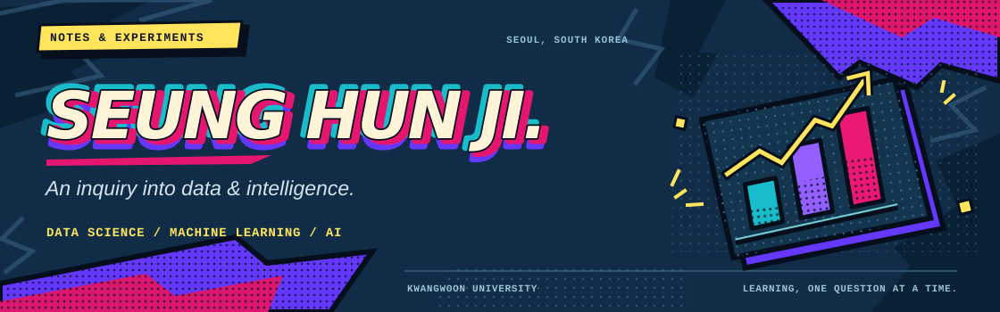
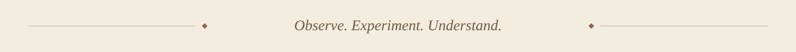

  

### A little background

I'm **Seung Hun Ji**, a Data Science student at **Kwangwoon University**, based in Seoul.

I explore how models learn from data, retrieve useful knowledge, and make recommendations. I care about thoughtful experiments, reproducible results, and clear explanations.

### Current interests

- **Tabular learning** — feature selection and learning from small datasets.
- **Knowledge & retrieval** — knowledge graphs, RAG, and grounded language models.
- **Recommendation & evaluation** — matching information to people and testing what works.

### The toolkit

| Area | Tools I work with |
| :--- | :--- |
| Analysis & modeling | Python · Pandas · scikit-learn · Jupyter |
| AI & retrieval | TabPFN · LangGraph · LlamaIndex · ChromaDB · Neo4j |
| Applications | FastAPI · Streamlit |
| Development | Git · GitHub · Docker |

 

  

